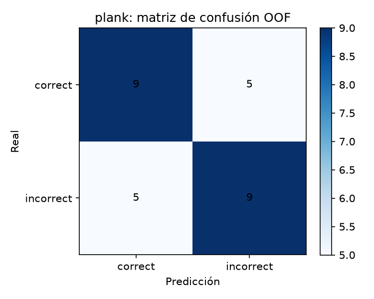
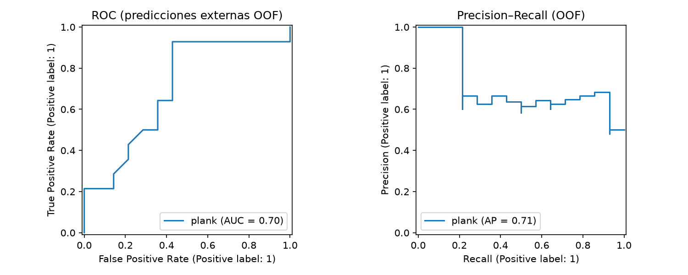
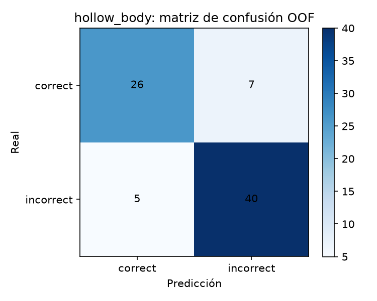
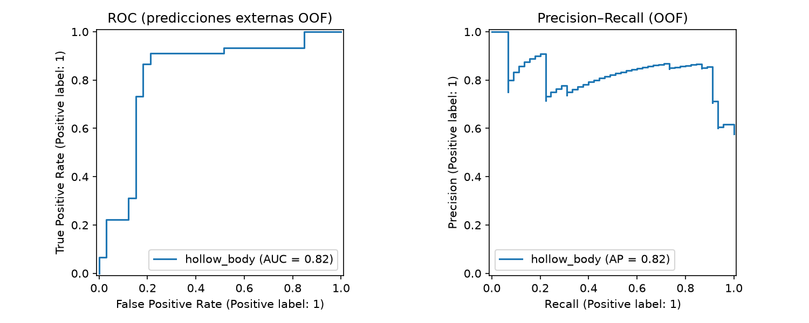

# KineSight — Entregable 1

Sistema de visión por computadora para evaluar en tiempo real la ejecución de
**Plank** y **Hollow Body Hold**. El alcance actual es clasificación binaria por
ventana temporal: `correct` frente a `incorrect`. No diagnostica errores
biomecánicos específicos ni sustituye una evaluación profesional.

Los modelos seleccionados son **Random Forest** para Plank y **SVM RBF** para
Hollow Body Hold. En validación cruzada anidada agrupada por participante,
obtuvieron F1 macro de **0.596 ± 0.398** y **0.801 ± 0.268**, respectivamente.
Las métricas son provisionales: los Gold contienen 7 y 9 participantes, y la
variabilidad entre folds es alta.

## 1. Descripción general

El sistema transforma landmarks 3D de MediaPipe Pose en características
biomecánicas y estadísticas temporales. Los modelos usan exclusivamente esas
características para clasificar cada ventana; identificadores, etiquetas,
vista de cámara, ruta de origen y contadores de calidad se conservan para
trazabilidad, pero no se usan como predictores.

| Ejercicio | Modelo seleccionado | F1 macro (media ± SD, outer OOF) | Recall `incorrect` |
|---|---|---:|---:|
| Plank | Random Forest | 0.596 ± 0.398 | 0.577 ± 0.403 |
| Hollow Body Hold | SVM RBF | 0.801 ± 0.268 | 0.895 ± 0.174 |

Las cifras se leen de los metadatos de los modelos y corresponden a las
predicciones out-of-fold de la validación externa. No representan una
validación clínica ni garantizan generalización a nuevas poblaciones.

## 2. Arquitectura del proyecto

```text
KineSight/
├── data/
│   ├── bronze/
│   │   ├── metadata/
│   │   │   ├── plank_metadata.csv
│   │   │   └── hollow_body_metadata.csv
│   │   └── videos/<exercise>/{correct,incorrect}/  # entrada local, no versionada
│   ├── silver/
│   │   ├── extracted_frames/<exercise>/<video_id>/frame_*.jpg
│   │   └── landmarks/<exercise>/
│   │       ├── <video_id>.parquet
│   │       └── *quality_observations.parquet
│   └── gold/
│       ├── plank_features.parquet
│       ├── hollow_body_features.parquet
│       └── *_feature_dictionary.json
├── models/
│   ├── pose/pose_landmarker.task
│   ├── plank/{model.joblib,model_metadata.json}
│   └── hollow_body/{model.joblib,model_metadata.json}
├── notebooks/
│   ├── 01_frames_extractor.ipynb
│   ├── 02_silver_landmarks.ipynb
│   ├── 03_gold_features.ipynb
│   ├── 04_bronze_to_gold.ipynb
│   ├── 05_model_training.ipynb
│   └── metadata_creation.ipynb
├── reports/
│   ├── plank/
│   └── hollow_body/
├── src/
│   ├── pipeline.py
│   ├── pose/landmarks.py
│   ├── preprocessing/{preparation.py,quality_control.py}
│   ├── features/{geometry.py,biomechanics.py,temporal.py}
│   ├── training/{experiment.py,train_plank.py,train_hollow_body.py}
│   └── inference/{live_camera.py,temporal_buffer.py}
├── tests/
├── evaluate_plank.py
├── evaluate_hollow_body.py
└── requirements.txt
```

`src.preprocessing` crea y valida metadata y extrae imágenes; `src.pose`
procesa los frames con MediaPipe; `src.features` contiene geometría 3D,
características biomecánicas y agregación temporal compartida; `src.pipeline`
coordina Bronze → Silver → Gold; `src.training` compara y entrena modelos; y
`src.inference` implementa captura, cálculo de características, buffer y
predicción en cámara. `tests` cubre esos cálculos, las entradas, inferencia,
artefactos y consistencia Gold/Silver.

Los directorios `src/exercises/` y `src/visualization/` existen como estructura
reservada, pero no contienen lógica activa en este entregable.

## 3. Instalación y configuración

La corrida documentada se realizó en Windows con Python **3.12.10**. El
repositorio no fija una versión mínima/máxima de Python ni incluye un lockfile;
`requirements.txt` declara rangos de dependencias. Se requiere una webcam y
permiso del sistema operativo para que OpenCV pueda acceder a ella únicamente
para la evaluación en vivo. La cámara física no se ha validado en esta
documentación.

```powershell
git clone https://github.com/gamerOZZY/KineSight.git
cd KineSight
python -m venv .venv
.\.venv\Scripts\Activate.ps1
python -m pip install --upgrade pip
python -m pip install -r requirements.txt
```

Las dependencias principales son MediaPipe, OpenCV, NumPy, Pandas, PyArrow,
scikit-learn, XGBoost, Joblib y Matplotlib. El notebook es opcional; Jupyter no
está incluido en `requirements.txt`.

El modelo MediaPipe Pose Landmarker Lite ya está versionado en
[`models/pose/pose_landmarker.task`](models/pose/pose_landmarker.task). Si se
elimina localmente, el código documenta la descarga oficial en
[Google Cloud Storage](https://storage.googleapis.com/mediapipe-models/pose_landmarker/pose_landmarker_lite/float16/1/pose_landmarker_lite.task).

**Datos fuente:** los videos crudos no están incluidos en Git (la carpeta
`videos/` está ignorada). La copia de trabajo usada para estos resultados
contenía 14 videos Plank y 17 Hollow Body, pero un clon limpio requiere obtener
los videos por separado y colocarlos en
`data/bronze/videos/<exercise>/{correct,incorrect}/`. Los CSV de metadata y
los artefactos derivados descritos abajo sí están versionados. La recolección
de los videos ocurrió fuera del pipeline reproducible del repositorio; por
tanto, este README describe el procesamiento a partir de los insumos Bronze
disponibles, no una captura de datos automatizada.

Metadata versionada: [Plank](data/bronze/metadata/plank_metadata.csv) ·
[Hollow Body Hold](data/bronze/metadata/hollow_body_metadata.csv).

## 4. Pipeline de datos: Bronze → Silver → Gold

### Datos disponibles

Las etiquetas se derivan de la carpeta (`correct` o `incorrect`) y se validan
contra el nombre del archivo (`good_...` o `bad_...`). Los metadatos incluyen
ID de video, participante, ejercicio, vista de cámara, duración y FPS.

| Ejercicio | Videos | Participantes | Ventanas Gold | Ventanas `correct` / `incorrect` | Vistas por video |
|---|---:|---:|---:|---:|---|
| Plank | 14 | 7 | 28 | 14 / 14 | `side`: 11; `back-side`: 3 |
| Hollow Body Hold | 17 | 9 | 78 | 33 / 45 | `side`: 14; `bottom-side`: 1; `top-side`: 1; `bottom`: 1 |

`error_type` es nulo en las 106 ventanas Gold actuales. Por ello, el problema
implementado es binario y no permite clasificar tipos de error.

### Bronze y extracción de landmarks

Los videos se esperan bajo `data/bronze/videos/<exercise>/correct/` o
`incorrect/`; sus metadatos están en
`data/bronze/metadata/<exercise>_metadata.csv`. Los nombres de video son
analizados y contrastados con metadata, etiqueta y vista para evitar
emparejamientos incorrectos.

La extracción guarda frames JPEG en
`data/silver/extracted_frames/<exercise>/<video_id>/` a **7 FPS**. MediaPipe
Pose Landmarker se ejecuta en modo `VIDEO`, en orden cronológico, con timestamps
en milisegundos reconstruidos a partir del FPS del video de origen y del índice
de frame muestreado. Esa reconstrucción asume video de tasa de cuadros
constante (CFR).

Se guarda una fila por frame en
`data/silver/landmarks/<exercise>/<video_id>.parquet`: 33 World Landmarks con
`x`, `y`, `z`, `visibility` y `presence` (165 campos), además de metadata,
timestamp, `pose_detected`, `landmark_count` y `processing_status`. Si una pose
o un campo opcional no está disponible, se conserva como nulo; no se sustituye
por cero ni se interpola. Observaciones inválidas de landmarks y características
se registran en archivos Parquet de quality control.

### Gold y características

Los datasets de ventanas se encuentran en
[`data/gold/plank_features.parquet`](data/gold/plank_features.parquet) y
[`data/gold/hollow_body_features.parquet`](data/gold/hollow_body_features.parquet).
Cada fila mantiene `video_id`, `participant_id`, ejercicio, `camera_view`,
`source_video`, etiqueta, `error_type`, límites de ventana, frame IDs y
contadores de calidad. `window_id` no es una columna: la ventana se identifica
por video y timestamps.

Los landmarks World usan el origen MediaPipe al centro de caderas; no se aplica
una traslación adicional. Las características se calculan independientemente
por variable y se documentan en los diccionarios
[`plank_feature_dictionary.json`](data/gold/plank_feature_dictionary.json) y
[`hollow_body_feature_dictionary.json`](data/gold/hollow_body_feature_dictionary.json).

* **Plank:** ángulos hombro-cadera-tobillo, hombro-cadera-rodilla,
  cadera-rodilla-tobillo, hombro-codo-muñeca, codo-hombro-cadera y alineación
  cabeza-cuello; desviación 3D de cadera y desviación vertical respecto de la
  línea hombros-tobillos, ambas normalizadas por longitud de torso.
* **Hollow Body Hold:** ángulos hombro-cadera-rodilla y cadera-rodilla-tobillo,
  orientación del torso, elevación de piernas, alineación de brazos y cabeza,
  distancia hombro-cadera normalizada por hombro-tobillo y distancia
  cadera-tobillo normalizada por longitud de torso.

Estas medidas son proxies geométricos de la pose; MediaPipe no mide
directamente el contacto lumbar con el suelo.

Las características se remuestrean a una grilla objetivo de **5 FPS** en
ventanas no solapadas de **2 segundos**, con tolerancia de 100 ms. Cada
característica exige al menos **5 observaciones válidas**; si no alcanza ese
mínimo, sus estadísticas quedan nulas y la observación se registra en QC. No se
interpolan landmarks. Por característica se calculan `mean`, desviación
estándar poblacional (`std`), `min`, `max`, `range` y pendiente temporal
(`slope`). Los predictores son 48 columnas biomecánicas/temporales (8
características × 6 estadísticas). Las columnas `*_valid_frames` y toda la
metadata se excluyen del entrenamiento.

## 5. Metodología de entrenamiento y validación

Se comparan seis algoritmos: Logistic Regression, SVM RBF, Random Forest, Extra
Trees, HistGradientBoosting y XGBoost. Las transformaciones están dentro de un
`sklearn.pipeline.Pipeline`: imputación por mediana para todos los modelos y
`StandardScaler` para Logistic Regression y SVM; los modelos de árboles no se
escalan. XGBoost adapta internamente las etiquetas binarias a enteros y devuelve
las etiquetas originales.

La validación usa `StratifiedGroupKFold` agrupado por `participant_id`: cinco
folds externos y hasta tres folds internos. Las ventanas de un participante
permanecen juntas en train o validación, evitando que el mismo sujeto aparezca
en ambos conjuntos. El código comprueba explícitamente el solapamiento de
participantes en los folds. Se comparan inicialmente todos los candidatos con
los mismos folds; los dos mejor posicionados pasan a tuning anidado. La
selección prioriza F1 macro y, como desempate, recall `incorrect`, Balanced
Accuracy y menor desviación estándar entre folds.

La imputación ocurre dentro de cada fold para evitar ajustar el preprocesamiento
con información de validación. Los reportes contienen resultados iniciales y
anidados por separado; las tablas siguientes son la comparación inicial
agrupada (sin tuning), y la tabla de modelos finales usa las métricas outer OOF
del tuning anidado.

## 6. Resultados experimentales y selección de modelos

Valores redondeados a tres decimales; cada celda muestra media ± desviación
estándar de los folds de la comparación inicial agrupada. La clase positiva de
recall es `incorrect`.

### Plank — comparación inicial

| Modelo | F1 Macro | Recall incorrect | Balanced Accuracy | ROC-AUC |
|---|---:|---:|---:|---:|
| Logistic Regression | 0.541 ± 0.311 | 0.617 ± 0.439 | 0.625 ± 0.306 | 0.647 ± 0.415 |
| SVM RBF | 0.514 ± 0.234 | 0.603 ± 0.370 | 0.585 ± 0.185 | 0.620 ± 0.391 |
| Random Forest | 0.668 ± 0.386 | 0.710 ± 0.413 | 0.688 ± 0.396 | 0.693 ± 0.423 |
| Extra Trees | 0.404 ± 0.304 | 0.710 ± 0.413 | 0.455 ± 0.292 | 0.660 ± 0.416 |
| HistGradientBoosting | 0.243 ± 0.060 | 0.600 ± 0.548 | 0.500 ± 0.000 | 0.500 ± 0.000 |
| XGBoost | 0.559 ± 0.380 | 0.537 ± 0.385 | 0.585 ± 0.397 | 0.667 ± 0.412 |

[CSV de comparación](reports/plank/cv_initial_model_comparison.csv) ·
[gráfica F1 macro](reports/plank/cv_initial_f1_macro.png) ·
[gráfica nested CV](reports/plank/nested_cv_f1_macro.png)

### Hollow Body Hold — comparación inicial

| Modelo | F1 Macro | Recall incorrect | Balanced Accuracy | ROC-AUC |
|---|---:|---:|---:|---:|
| Logistic Regression | 0.654 ± 0.217 | 0.637 ± 0.323 | 0.760 ± 0.129 | 0.806 ± 0.147 |
| SVM RBF | 0.779 ± 0.243 | 0.835 ± 0.304 | 0.850 ± 0.150 | 0.863 ± 0.130 |
| Random Forest | 0.663 ± 0.326 | 0.835 ± 0.304 | 0.709 ± 0.291 | 0.828 ± 0.273 |
| Extra Trees | 0.792 ± 0.255 | 0.835 ± 0.304 | 0.865 ± 0.162 | 0.852 ± 0.231 |
| HistGradientBoosting | 0.621 ± 0.213 | 0.724 ± 0.267 | 0.709 ± 0.177 | 0.848 ± 0.122 |
| XGBoost | 0.505 ± 0.156 | 0.568 ± 0.349 | 0.587 ± 0.164 | 0.741 ± 0.196 |

[CSV de comparación](reports/hollow_body/cv_initial_model_comparison.csv) ·
[gráfica F1 macro](reports/hollow_body/cv_initial_f1_macro.png) ·
[gráfica nested CV](reports/hollow_body/nested_cv_f1_macro.png)

### Modelos finales y análisis de errores

| Ejercicio | Algoritmo y parámetros del artefacto | F1 Macro outer OOF | Recall incorrect | Balanced Accuracy | ROC-AUC |
|---|---|---:|---:|---:|---:|
| Plank | Random Forest: `n_estimators=250`, `max_depth=3`, `min_samples_leaf=1`, `max_features=sqrt`, `class_weight=balanced` | 0.596 ± 0.398 | 0.577 ± 0.403 | 0.622 ± 0.410 | 0.650 ± 0.397 |
| Hollow Body Hold | SVM RBF: `C=0.5`, `gamma=scale`, `class_weight=balanced` | 0.801 ± 0.268 | 0.895 ± 0.174 | 0.810 ± 0.288 | 0.850 ± 0.149 |

Los hiperparámetros se leen de `model_metadata.json`; Random Forest no usa
escalado y SVM sí. Las métricas son de los cinco folds externos de la validación
anidada, calculadas sobre ventanas no vistas de participantes separados.
Metadatos completos: [modelo Plank](models/plank/model_metadata.json) ·
[modelo Hollow Body Hold](models/hollow_body/model_metadata.json).

Para Plank, las cinco mayores importancias impurity-based reportadas son
`hip_deviation_norm_max` (0.078), `shoulder_hip_ankle_angle_mean` (0.072),
`hip_deviation_norm_mean` (0.071), `shoulder_hip_ankle_angle_max` (0.059) y
`hip_vertical_deviation_norm_mean` (0.059). Son asociaciones del Random Forest,
no explicaciones causales. El CSV completo está en
[`reports/plank/feature_importance.csv`](reports/plank/feature_importance.csv).
Para el SVM RBF de Hollow Body no se genera una importancia nativa por
característica.

En las matrices outer-OOF, Plank tuvo **5 falsos negativos**: ventanas
`incorrect` clasificadas como `correct` (5 de 14 incorrectas). Hollow Body
también tuvo **5 falsos negativos** (5 de 45 incorrectas). Estos errores
reflejan los recalls de 0.577 y 0.895. Las matrices no identifican qué error
biomecánico ocurrió; `error_type` está completamente vacío.









## 7. Guía de ejecución

Ejecutar desde la raíz y con el entorno virtual activado. El entrenamiento lee
los Parquet Gold, compara los seis algoritmos y actualiza
`models/<exercise>/` y `reports/<exercise>/`:

```powershell
python -m src.training.train_plank
python -m src.training.train_hollow_body
```

Para regenerar Bronze → Silver → Gold se necesitan los videos originales,
ausentes de Git. La fase `all` ejecuta preparación, landmarks y features. En
esta copia ya existen Parquet Silver/Gold, por lo que un reprocesamiento requiere
`--overwrite`; la extracción de frames completa se conserva:

```powershell
python -m src.pipeline --exercise plank --phase all --overwrite
python -m src.pipeline --exercise hollow_body --phase all --overwrite
```

Las imágenes de frames se generan a 7 FPS; las ventanas Gold usan los valores
documentados en la sección 4. `python -m src.pipeline --help` muestra opciones
para ejecutar cada fase por separado.

Para inferencia en cámara:

```powershell
python evaluate_plank.py
python evaluate_hollow_body.py
```

La cámara predeterminada es el índice OpenCV `0`; se puede cambiar, por ejemplo,
con `python evaluate_plank.py --camera 1`. La ventana muestra si la pose fue
detectada, el estado de calidad y la etiqueta predicha. Se requiere una pose
completa y características válidas: visibility y presence usan umbral **0.5**
cuando el campo está disponible; si un valor requerido falta o la ventana no
alcanza el mínimo por característica, no se emite una predicción. El buffer en
vivo contiene 2 segundos a 5 FPS (10 muestras) y exige al menos 5 muestras
válidas por característica. La etiqueta se estabiliza por voto mayoritario de
hasta las últimas 5 predicciones; el historial se borra al perder la pose o la
calidad. Presiona **Q** para cerrar la aplicación. La interfaz marca los
modelos como experimentales y no presenta porcentajes de confianza.

## 8. Pruebas y validación del sistema

Ejecuta la suite con `unittest` (no se requiere instalar pytest):

```powershell
python -m unittest discover -s tests -v
```

La última ejecución verificada terminó con **24 pruebas aprobadas**. Los tests
cubren cálculos geométricos, validación de características, ventanas sin mezcla
de etiquetas, entrada de video/metadata, buffer temporal, estabilización de
predicciones, ciclo de vida de la cámara, compatibilidad del candidato XGBoost
y carga/predicción con los artefactos finales.

`_validate_splits` y el tuning anidado comprueban que no haya participantes
compartidos entre train y validación; `reports/<exercise>/dataset_audit.json`
guarda los folds y el solapamiento auditado. La prueba
[`test_gold_inference_consistency.py`](tests/test_gold_inference_consistency.py)
reconstruye ventanas desde Silver con el extractor biomecánico y el agregador
temporal compartidos y compara sus estadísticas con Gold, comprobando
consistencia entre el cálculo de entrenamiento y serving. También se prueba
que los modelos guardados respeten el orden de características de metadata.

Los comandos de ayuda del pipeline y de ambos evaluadores fueron ejecutados
durante la revisión. El CLI de cámara se validó sin iniciar captura; no se
dispuso de una cámara física para probar inferencia visual de extremo a extremo.

## 9. Limitaciones conocidas y trabajo futuro

* El tamaño muestral es reducido: 7 participantes Plank y 9 Hollow Body, menor
  al umbral operativo de 12 participantes configurado por el experimento.
  Tres participantes Plank y cinco Hollow Body aparecen con una sola clase;
  la variabilidad entre folds es alta.
* Las vistas de cámara y condiciones de captura son limitadas. La posición,
  iluminación, oclusiones y visibilidad pueden impedir la extracción o
  degradar las características.
* `error_type` no tiene anotaciones disponibles; el modelo no ofrece
  diagnóstico granular ni retroalimentación causal. La detección de pose no
  mide contacto lumbar con el suelo.
* La reconstrucción de timestamps asume videos CFR. El SVM RBF no ofrece
  importancia nativa por característica y las importancias impurity-based del
  Random Forest pueden estar sesgadas; ninguna debe interpretarse causalmente.
* No se han calibrado probabilidades ni se ha probado el rendimiento en una
  cámara física en este entregable. Los resultados son experimentales y no
  deben utilizarse como evaluación clínica.

El Entregable 2 puede ampliar el dataset con más participantes y anotaciones
consistentes, agregar clasificación multiclase de tipos de error, diseñar
retroalimentación biomecánica específica y medir/optimizar latencia en las
condiciones reales de uso.
